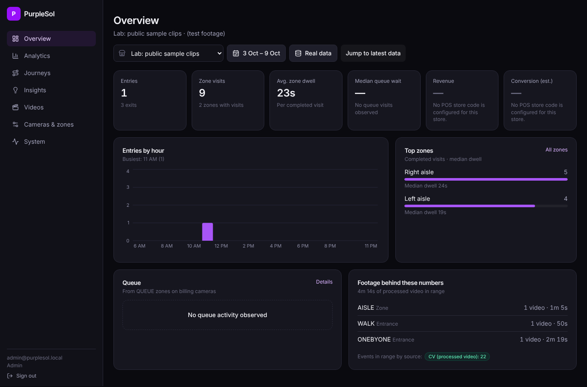
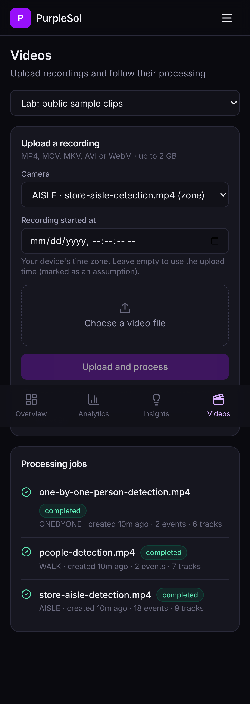

# PurpleSol: retail analytics from existing CCTV

> Google Analytics for physical stores. Anonymous footfall, zone visits, dwell
> time, queues and POS correlation from the cameras a store already has. No
> facial recognition and no demographics.

**Status (October 2026):** v2 works end to end on a local stack and in CI, and
has been validated on public test clips. It is **not deployed yet** and has
**not yet been validated on real store footage**. See
[docs/BUILD_SUMMARY.md](docs/BUILD_SUMMARY.md) for the full checklist.

| Overview (desktop) | Phone |
|:---:|:---:|
|  |  |

Screenshots show a lab store built from public sample clips. The older images in
`screenshots/` are from the v1 demo, which used invented data.

## What it does

1. Upload a CCTV recording for a camera, from a phone or a laptop.
2. A background worker detects people (YOLO11n), tracks them (ByteTrack) as
   anonymous numbers, and turns their movement into events: entries and exits
   across a drawn line, zone visits with dwell time, queue waits and whether the
   person reached the counter.
3. The dashboard reports footfall, zones, queues, journeys, revenue and an
   estimated conversion rate (needs POS data), plus rule-based anomalies and
   insights. Every number shows its definition and where its data came from;
   sample data is never mixed with real data unless you ask for it.

## Architecture

```
Browser ──► Next.js (Vercel) ── /api ──► FastAPI (Railway) ──► PostgreSQL (Neon)
   │                                                              ▲   (data + job queue)
   └── presigned upload ──► S3 / Cloudflare R2 ◄── CV worker (Railway) ┘
```

## Run it locally

Requirements: Docker, or Python 3.11 + Node 22 + PostgreSQL.

```bash
docker compose up --build                 # Postgres, migrations, API :8000, worker
cd frontend && npm ci && npm run dev      # dashboard :3000
```

Or open the repo in GitHub Codespaces: setup runs automatically, then `make dev`.
Sign-in details for development are in `.devcontainer/docker-compose.yml`.

Useful commands (from the repo root): `make test`, `make lint`, `make seed`
(adds the bundled sample data, labelled as sample).

## Check the computer vision yourself

```bash
cd backend
python -m app.cv.process_videos clip.mp4 --config camera.json --out out/   # events, tracks, snapshots
python -m app.cv.evaluate eval/public_clips.json --media-dir /path/to/clips # compare with hand counts
```

Results on public clips: detection precision 1.00 and recall 0.95 on 58 people;
visitor and entry counts correct on all 3 counting clips. Method and limits:
[docs/CV_VALIDATION.md](docs/CV_VALIDATION.md).

## Documentation

| Document | What it covers |
|---|---|
| [BUILD_SUMMARY](docs/BUILD_SUMMARY.md) | What works, with evidence; what is blocked; risks |
| [PROJECT_AUDIT](docs/PROJECT_AUDIT.md) | Problems found in v1 and how each was fixed |
| [DEPLOYMENT](docs/DEPLOYMENT.md) | Neon, R2, Railway and Vercel, step by step |
| [REMOTE_ACCESS](docs/REMOTE_ACCESS.md) | Using and changing PurpleSol from a phone |
| [CV_VALIDATION](docs/CV_VALIDATION.md) | Accuracy, speed, setup advice for cameras |
| [METRICS](docs/METRICS.md) | Definition of every number on the dashboard |
| [DECISIONS](docs/DECISIONS.md) | Engineering decisions and their trade-offs |
| [IMPLEMENTATION_PLAN](docs/IMPLEMENTATION_PLAN.md) | Phases, status, next steps |
| [BUILD_LOG](docs/BUILD_LOG.md) | What was done, in order |

Docs numbered `00` to `20` describe the original v1 design and hackathon pitch.
Where they disagree with the files above, the files above are current.

## Privacy

People are tracked only as anonymous numbers within one video. Nobody is
identified, no face recognition is used, and no age or gender is estimated.
Uploaded footage and job snapshots stay in a private bucket, behind login, and
videos are deleted after `VIDEO_RETENTION_DAYS` (default 30).
Never commit CCTV footage to this repository.

## Author

Aditya Khabya ([@tecsmurf](https://github.com/tecsmurf)). Built for the Purplle
Hackathon 2026.
